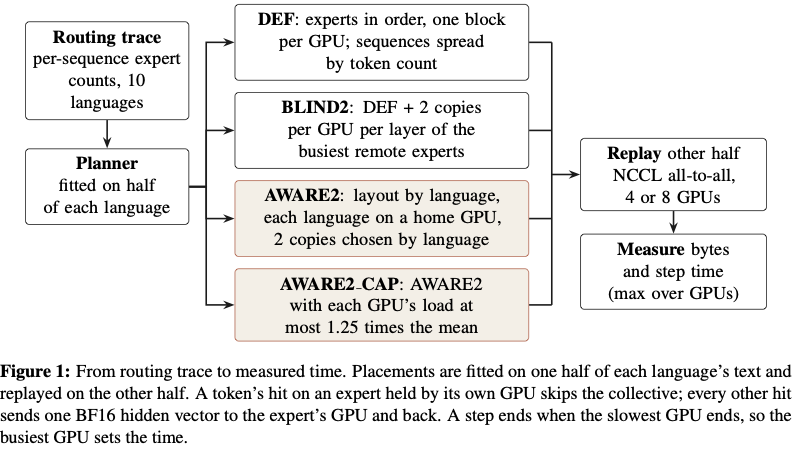
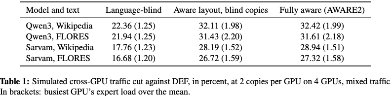
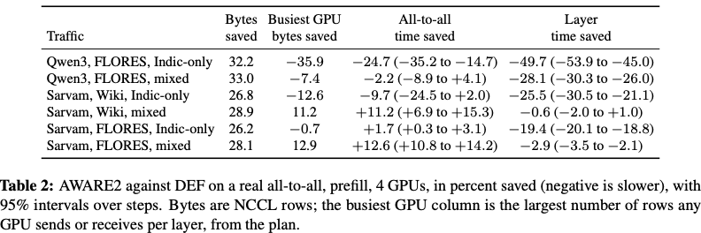
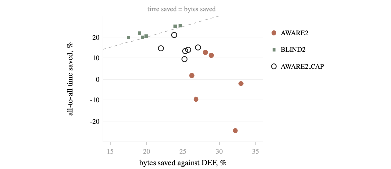

# Fewer Bytes, Not Less Time:

## Language-Aware Expert Placement for Multilingual MoE Serving

Ramji and the Vizuara Research Team

Vizuara AI Labs

### Abstract

Multilingual mixture-of-experts models route tokens differently by language, which suggests placing experts so that each language’s tokens stay on fewer GPUs. We test this on Qwen3-30B-A3B and Sarvam-30B with English and nine Indian languages. Routing separates English from the Indian languages on both models, and parallel text keeps 92% and 77% of that split. In simulation, homing each language on one GPU and laying experts out by language cuts cross-GPU traffic by 10 to 11 points more than language-blind copies of busy experts. On four H200s, replaying recorded routing through NCCL all-to-all reduces bytes by 25.7 to 32.2% in decode and 26.2 to 33.0% in prefill relative to the default layout. The repeat check failed in 3 of 12 cells; under the run’s rule, no latency verdict is trusted, including prefill. On four L40S GPUs, capped language-aware placement reduces logical bytes per generated token by 2.02% on Indic-only traffic and 4.99% on the full mix relative to equal-memory blind copies, without establishing faster decode. The cap lowers planned peak load but hardly changes live imbalance. These results show why fewer total bytes need not shorten a step whose completion depends on its slowest GPU.

### 1 Introduction

Expert parallelism spreads the experts of a mixture-of-experts (MoE) layer over several GPUs, and every token whose chosen expert lives on another GPU must cross the interconnect twice, once to the expert and once back. Placement papers reduce that traffic by putting experts that are chosen together on the same GPU [6, 10, 12], and the newest condition the plan on a workload class: task families in TACG [11] and domains in Bambhaniya et al., who report up to 20% less all-to-all data [1]. Interpretability work shows, separately, that multilingual MoEs route by language in their early and late layers [2, 3, 14]. A request’s language is known before the first MoE layer, so it is a cheap signal for placement. We found no work that conditions placement on language.

For Indian-language serving the question is practical. A model that serves English and nine Indian languages pays for every token that leaves its GPU, and a placement that keeps a language’s tokens local would cut that cost without changing the model. The open issue is whether fewer bytes means less time.

We recorded expert routing on two 30B MoEs in ten languages, built placements from half the text, and scored them on the other half: first in simulation, then on a real all-to-all. We also measured full-model decode on four L40S GPUs. Our findings:

• Routing separates English from the Indian languages, on both models and on parallel text; differences among Indian languages are small.

• The simulated saving comes from the layout and the home GPU, not from choosing copies by language. Language-chosen copies add under 1 point.

• Language-aware placement reduces real communication bytes, but the H200 replay under its run-wide timing rule and the L40S full-model measurements do not establish faster decode.

• The observed prefill ordering favors blind copies, while the L40S cap improves fit balance without improving live balance. These observations motivate accounting for the busiest GPU, but do not establish a causal latency benefit from the cap.

### 2 Setup

**Models and text.** Qwen3-30B-A3B has 48 MoE layers with 128 experts and chooses 8 per token; Sarvam-30B has 18 MoE layers, chooses 6, and has a shared expert that we do not count. Routing was recorded in BF16. For every token at every MoE layer we recorded the experts the router chose, as per-sequence counts, without keeping the text. The text is Wikipedia in English, Hindi, Bengali, Tamil, Telugu, Marathi, Gujarati, Kannada, Malayalam and Punjabi (96 sequences of 512 tokens per language), the same 500 FLORES sentences in each language [TODO: citation: FLORES-101], and two code-mixed sets, romanised Hinglish with its English side and Tanglish. The first half of each language’s text designs a placement and the second half scores it.

**Routing divergence.** We compare languages by the Jensen-Shannon divergence between their expert distributions at each layer, in bits, averaged over layers. The floor is the same measure between two halves of one language.

**Placements.** Figure 1 shows the four arms on G GPUs. AWARE2 is the fully language-aware policy: experts are laid out to maximise each language’s hits on its home GPU, each language’s sequences go to that GPU, and two copies per GPU per layer are chosen by language. BLIND2 spends the same copy memory without regard to language. In simulation, the traffic cut is the share of token-expert hits that no longer leave their GPU, relative to DEF, and imbalance is the busiest GPU’s expert load over the mean.

**Real all-to-all.** The replay runs used H200 GPUs over NVLink. We replay the evaluation-half counts for Qwen3 on FLORES and Sarvam on Wikipedia and FLORES, with Indic-only traffic (nine Indian languages) and mixed traffic (plus English). Each remote token-expert hit sends one BF16 vector to its expert’s GPU in a single NCCL all-to-all with exact split sizes, and the combine sends it back. One pass times the all-to-all alone; a second adds a SwiGLU expert FFN of the same FLOPs on every hit a GPU serves, which we call layer time. Prefill is 8 steps of whole sequences, up to 2,048 tokens per GPU; decode is 16 steps of 64 sequences per GPU, one token each. Step time is the maximum over GPUs from a common barrier; we take the median over 6 repeats (2 on 8 GPUs), the paired ratio against DEF per step, and a bootstrap over steps for 95% intervals. A second DEF arm is an A/A control. The decision rule for each experiment was fixed before it ran.

**L40S follow-up.** Sarvam-30B runs with PyTorch/NCCL, fixed continuations, and the same two-copy memory budget across layouts. Three paired repeat blocks use 64 decode positions per request; a duplicate blind layout checks repeatability. Separate 12-step diagnostic passes measure NCCL intervals, and unprofiled passes supply latency. The static cap constrains predicted executed work after replica selection on fit data: 1.25× on Indic-only and a 1.15× full-mix sensitivity. These fit constraints do not guarantee balance on realized decode steps.

### 3 Results

#### Language structure in routing

English and the nine Indian languages used different expert distributions in both Qwen3-30B-A3B and Sarvam-30B. On Wikipedia, mean English–Indic Jensen–Shannon divergence was 0.318 bits for Qwen3 and 0.274 bits for Sarvam, against within-language split-half floors of 0.013 and 0.018 bits. Every MoE layer exceeded three times its model's floor. On parallel FLORES text, the divergences were 0.294 and 0.212 bits, retaining approximately 92% and 77% of the Wikipedia values. Thus the split persisted when the text content was matched across languages.

Differences among the Indian languages were smaller and more sensitive to the text. Their mean pairwise divergences fell from 0.035 to 0.017 bits on Qwen3 and from 0.071 to 0.038 bits on Sarvam between Wikipedia and FLORES. The routing signal is therefore primarily an English–Indic split. The code-mixed prediction was not supported: romanised Hinglish was closer to Hindi than English in early layers under the original reference, and its position changed with the reference text. We treat code-mixed traffic as a separate class rather than assigning it an English-like routing profile. The padding control also failed, so FLORES routing was collected one sentence at a time; a recorded route is not guaranteed to remain identical under a different batch shape.

#### Simulated locality and balance

With four simulated GPUs and two extra expert copies per GPU per layer, fully language-aware placement improved the simulated traffic-reduction percentage by 9.67–11.18 percentage points over language-blind copies across the two models and the Wikipedia/FLORES datasets. Both reductions used the default layout as their reference. Nearly all of the additional benefit came from the layout and request home assignment: blind copies on the aware layout came within 0.2–0.8 percentage points of fully aware copies. The gain came with greater imbalance. On Wikipedia, busiest-rank expert work divided by mean rank work was 1.99 for aware versus 1.25 for blind placement on Qwen3, and 1.51 versus 1.23 on Sarvam.

The Qwen3/Wikipedia aggregate-count ablation showed that a balance-aware planner could retain most of the simulated locality benefit. At the same two-copy budget, the capped integer-program plan reduced remote expert hits by 32.01%, compared with 33.05% for unconstrained aware placement, while mean layer imbalance fell from 1.987 to 1.261. These percentages use a no-copy, uniform-origin reference. The fit constraint applies to primary load before replica dispatch and does not guarantee a bound on live executed work.

Exact recorded-request shuffles supported an additional benefit from the original language/home association. On four simulated GPUs with two copies and token-work weighting, original groups exceeded the mean of refitted shuffled groups by 6.80 percentage points of remote-hit reduction on Indic-only Sarvam/Wikipedia, 6.95 on Qwen3/FLORES, and 5.68 on Sarvam/FLORES. Equal-sequence weighting and sentence-matched FLORES shuffles retained positive differences. The control preserves group request counts and uses independently shuffled fit and evaluation records; it is conditional on the selected home-group capacities, not a pipeline-wide significance test. These simulations measure remote expert-hit proxies and load, not network traffic or latency.

#### H200 replay: fewer bytes, provisional timing directions

In the four-H200 NVLink replay experiments, uncapped language-aware placement reduced communication payload by 25.7–32.2% in decode and 26.2–33.0% in prefill relative to the default layout. The capped plan reduced prefill payload by 22.0–27.1%, and language-blind copies reduced it by 17.3–24.4%, also relative to the default. These baselines differ from the blind-copy baseline used for the L40S comparisons below.

The H200 repeat check failed in 3 of 12 cells, almost all in decode; under the run's decision rule, every latency verdict from that run is not trusted, including prefill. We therefore claim no change in decode and report the prefill timings as consistent observed directions, not established effects. Uncapped aware placement showed a slower layer in five of six prefill cells, by up to 49.7%; the remaining cell's layer-time interval included zero. The capped plan showed 8–15% lower layer time than the default, while blind copies showed 13–19% lower layer time and were faster than the capped plan in all six cells. Thus blind copies saved fewer bytes but had the lowest observed layer times, subject to the run-wide timing qualification.

#### L40S fixed-continuation decode and cap audit

On four L40S GPUs, with fixed continuations and equal replica memory, uncapped and load-capped language-aware placement reduced logical all-to-all bytes per generated token by 5.09% and 4.99%, respectively, on the full traffic mix and by 2.06% and 2.02% on Indic-only traffic, relative to language-blind copies. The capped plan's paired median inter-token latency was 1.12% lower on the full mix and 0.37% higher on Indic-only. These measurements did not establish a decode speedup.

The static cap lowered planned peak load but barely changed live mean layer-step imbalance. On Indic-only, the 1.25× cap reduced the fit peak from 1.282 to 1.243, while live imbalance changed from 1.595 to 1.594. On the full mix, a 1.25× cap left the plan unchanged, so the measured 1.15× plan was a sensitivity test; it reduced the fit peak from 1.201 to 1.149, while live imbalance changed from 1.526 to 1.530. The cap constrained predicted executed expert work on fit data after replica selection, not the realized load of every decode step. Its failure to improve realized balance helps explain why it did not establish a latency benefit.

Instrumented NCCL intervals occupied about 22–29% of the L40S diagnostic decode step in the blind and capped comparisons, including waiting for the slowest GPU. Their share was noisy: it fell from 29.0% to 22.0% between blind and capped placement on the full mix, while identical blind layouts measured 27.1% and 22.6% on Indic-only. These intervals do not justify a proportional conversion from byte savings to step-time savings. They include synchronization and waiting and are not isolated physical link time. The remainder of the step includes model computation and host work, which were not timed separately. Primary latency results come from the separate unprofiled runs.

#### Combined hardware results

Changes are relative to the baseline named in each row. Negative time changes mean faster; positive changes mean slower. L40S inter-token latency (ITL) changes are medians of paired repeat changes, not ratios of arm medians.

| Hardware and measurement | Traffic | Placement | Baseline | Communication reduction | Time result |
|---|---|---|---|---|---|
| 4 × L40S, full-model decode | Full mix | Uncapped aware | Blind copies, equal replica memory | 5.09% logical bytes/token | Median ITL −1.56%; no established speedup |
| 4 × L40S, full-model decode | Full mix | Capped aware, 1.15× sensitivity | Blind copies, equal replica memory | 4.99% logical bytes/token | Median ITL −1.12%; no established speedup |
| 4 × L40S, full-model decode | Indic-only | Uncapped aware | Blind copies, equal replica memory | 2.06% logical bytes/token | Median ITL −0.28%; no established speedup |
| 4 × L40S, full-model decode | Indic-only | Capped aware, 1.25× | Blind copies, equal replica memory | 2.02% logical bytes/token | Median ITL +0.37%; no established speedup |
| 4 × H200, NVLink decode replay | Six model/text/traffic cells | Uncapped aware | Default layout | 25.7–32.2% payload | We claim no change in decode [^h200] |
| 4 × H200, NVLink prefill layer replay | Six model/text/traffic cells | Uncapped aware | Default layout | 26.2–33.0% payload | Observed slower in five of six cells, by up to 49.7% [^h200] |
| 4 × H200, NVLink prefill layer replay | Same six cells | Capped aware, 1.25× | Default layout | 22.0–27.1% payload | Observed layer time 8–15% lower; slower than blind copies in all six [^h200] |
| 4 × H200, NVLink prefill layer replay | Same six cells | Blind copies | Default layout | 17.3–24.4% payload | Observed layer time 13–19% lower; faster than capped aware in all six [^h200] |

[^h200]: The four-H200 repeat check failed in 3 of 12 cells, almost all in decode. Under the run's decision rule, **every latency verdict from that run is not trusted, prefill included**. The prefill timings show consistent observed directions, not established effects. The payload reductions remain reported separately from these timing verdicts.

The H200 cells cover Qwen3/FLORES, Sarvam/Wikipedia, and Sarvam/FLORES, each with Indic-only and mixed traffic. H200 layer timings include replayed communication and a FLOP-matched expert FFN; L40S timings measure Sarvam-30B full-model decode in the research runtime. These are complementary experiments, not a controlled hardware comparison. L40S byte totals describe logical payload; physical link traffic was not measured. Across these experiments, lower communication volume alone did not establish faster decode, and a cap that improved planned balance did not necessarily improve live balance.

Table 2 timing qualification: the H200 repeat check failed in 3 of 12 four-GPU cells. Under the run-wide rule, every latency verdict is not trusted, prefill included. These intervals show observed directions, not established effects.

**Figure 2:** Bytes against time for the six prefill cells on 4 GPUs. The original plotted values are retained. Blind copies save fewer bytes but show lower observed all-to-all times; the cap moves AWARE2 toward blind copies. The run-wide timing qualification above applies to every timing point. The dashed proportionality line is a reference, not a bound or a validated prediction of time savings.

### 4 Related work

ExFlow, Occult and MoETuner place co-selected experts together [6, 10, 12], Sem-MoE co-schedules data and experts [9], and TACG and Bambhaniya et al. condition placement on task family and domain [1, 11]. Load-only replication, as in DeepSeek’s EPLB [4, 5], sees per-expert load but not language. Lina and METRO show that tail latency and decode time depend on balance across GPUs as much as on volume [8, 13], which motivates evaluating balance alongside bytes here. On the language side, Bandarkar et al., Chen et al. and RISE report language-specific routing in early and late layers [2, 3, 14], and language-specific expert pruning works in translation models [7]. None of these measures placement by language on a real all-to-all.

### 5 Limitations

**Two models and one serving shape.** The H200 replay runs used an all-to-all and a FLOP-matched expert FFN, with no attention, KV cache or serving engine, and they ran on H200 GPUs over NVLink, not the PCIe servers the topic set out to study, so absolute times may differ there. The A/A control failed in 3 of 12 cells on 4 GPUs and 4 of 12 on 8, almost all in decode; under our rule every latency verdict is therefore not trusted, prefill included, although every prefill A/A point on 4 GPUs was within 0.05% of zero. Placements come from an earlier planner with equal weight per language. Decode tokens use token-level expert sets rebuilt from per-sequence counts. A padding control failed: for about 10% of token-layer pairs the chosen expert set depends on the batch, so FLORES ran one sentence at a time, and a trace from one batch shape is not an exact record of another. A third model was not run.

The separate L40S follow-up measures full-model decode in a research runtime, not production serving. Physical link traffic was not measured, and NCCL intervals include synchronization and waiting. The underlying exp03 raw records were not independently reanalysed for this revision.

### 6 Discussion

For saved bytes to save time, the reduction must reach the work that determines when the step finishes. In an expert-parallel collective, a rank can wait even after its own transfers or expert computation are complete. Reducing aggregate payload while leaving the slowest rank's work unchanged need not shorten the step. The observed H200 prefill ordering and the L40S cap audit are consistent with this explanation, but they do not isolate its causal contribution. In particular, the H200 timing rule prevents treating the observed ordering as an established performance effect.

A useful planner would therefore need to control realized load after requests are assigned and replicas are selected, rather than only the fit-time peak. Possible changes include spreading a language's requests over multiple home GPUs, selecting replicas according to current demand, or adapting placement as the traffic mix shifts. Each change may increase remote transfers, scheduling work, or migration costs. The relevant question is whether it reduces the slowest rank's completion time at the same memory budget after those costs are included. These are candidate mechanisms, not tested improvements in this study.

The runtime would also need enough exposed communication on the critical path for a byte reduction to matter. The L40S NCCL intervals include synchronization and waiting, so their 22–29% share cannot be multiplied by a payload reduction to predict a speedup. A timeline that separates transfer, expert work, host work, and waiting would help identify whether a better dispatcher, different overlap, or a different transport can convert locality into shorter steps. The shared-memory transport observed on L40S and the NVLink replay on H200 are different execution conditions, not a controlled comparison of interconnects.

Any claim of improvement would require repeat checks that pass, matched inputs and replica memory, and paired latency measurements against blind copies. Until then, fewer bytes are a demonstrated benefit, while faster decode remains unestablished.

### References

[1] Abhimanyu Bambhaniya et al. Scaling multi-node mixture-of-experts inference using expert activation patterns. arXiv preprint arXiv:2604.23150, 2026.

[2] Lucas Bandarkar et al. Multilingual routing in mixture-of-experts. ICLR 2026.

[3] Yuxin Chen et al. Understanding multilingualism in mixture-of-experts LLMs: Routing mechanism, expert specialization, and layerwise steering. arXiv preprint arXiv:2601.14050, 2026.

[4] DeepSeek-AI. DeepSeek-V3 technical report. arXiv preprint arXiv:2412.19437, 2024.

[5] DeepSeek-AI. EPLB: Expert parallelism load balancer. GitHub repository, 2025.

[6] Seokjin Go, Divya Mahajan. MoETuner: Optimized mixture of expert serving with balanced expert placement and token routing. arXiv preprint arXiv:2502.06643, 2025.

[7] Yeskendir Koishekenov, Alexandre Berard, Vassilina Nikoulina. Memory-efficient NLLB-200: Language-specific expert pruning of a massively multilingual machine translation model. arXiv preprint arXiv:2212.09811, 2022.

[8] Jiamin Li et al. Accelerating distributed MoE training and inference with Lina. arXiv preprint arXiv:2210.17223, 2022.

[9] Yan Li et al. Semantic parallelism: Redefining efficient MoE inference via model-data co-scheduling. ICLR 2026.

[10] Shuqing Luo et al. Occult: Optimizing collaborative communication across experts for accelerated parallel MoE training and inference. ICML 2025.

[11] Zhiyao Xu et al. Beyond task-agnostic: Task-aware grouping for communication-efficient multi-task MoE inference. arXiv preprint arXiv:2606.01007, 2026.

[12] Jinghan Yao et al. Exploiting inter-layer expert affinity for accelerating mixture-of-experts model inference. arXiv preprint arXiv:2401.08383, 2024.

[13] Yanpeng Yu et al. Efficient MoE serving in the memory-bound regime: Balance activated experts, not tokens. arXiv preprint arXiv:2512.09277, 2025.

[14] Kening Zheng et al. Unveiling language routing isolation in multilingual MoE models for interpretable subnetwork adaptation. Findings of EMNLP 2026.