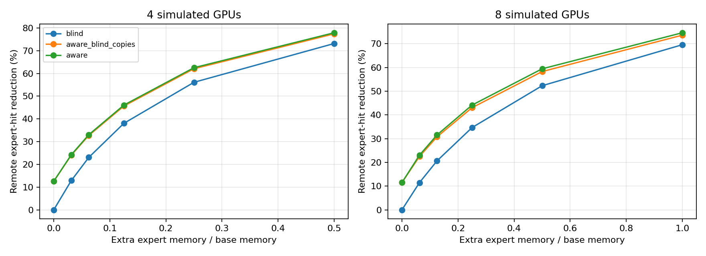
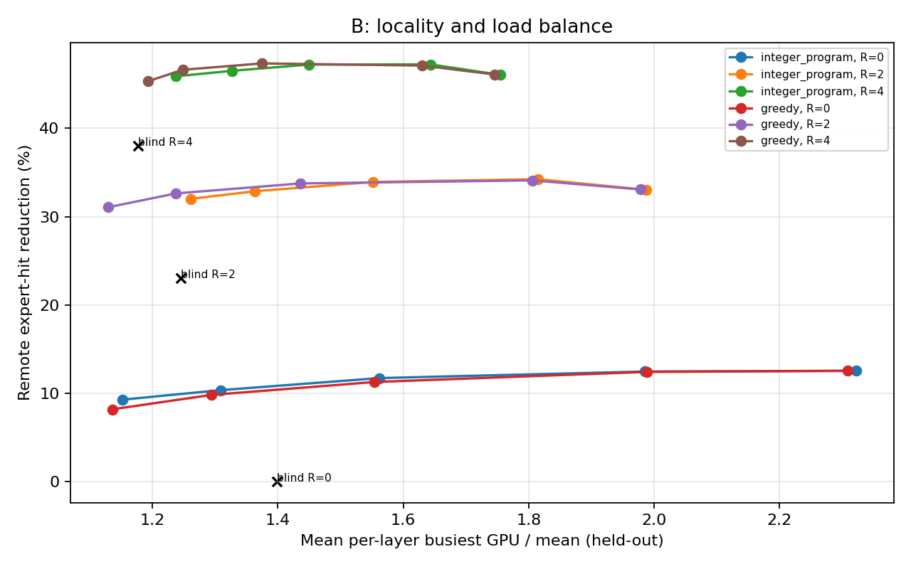
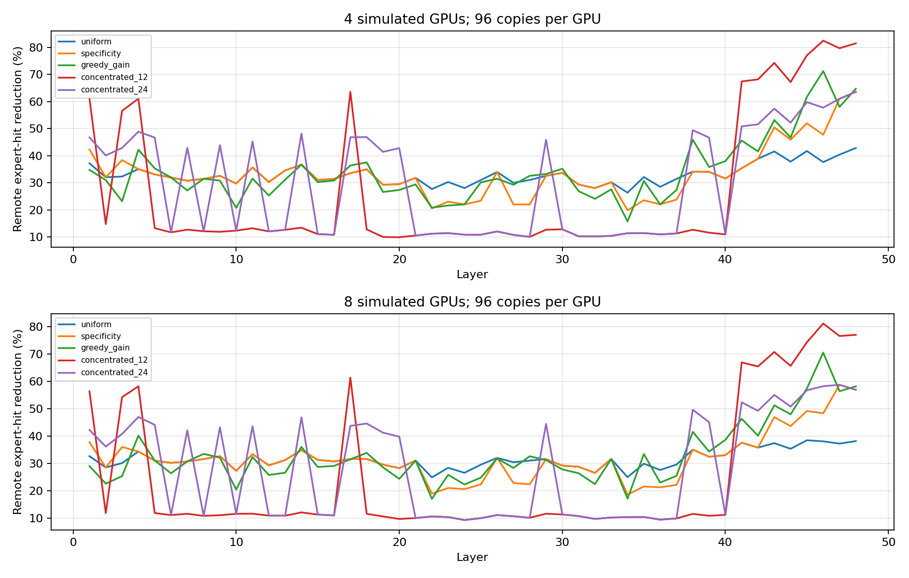
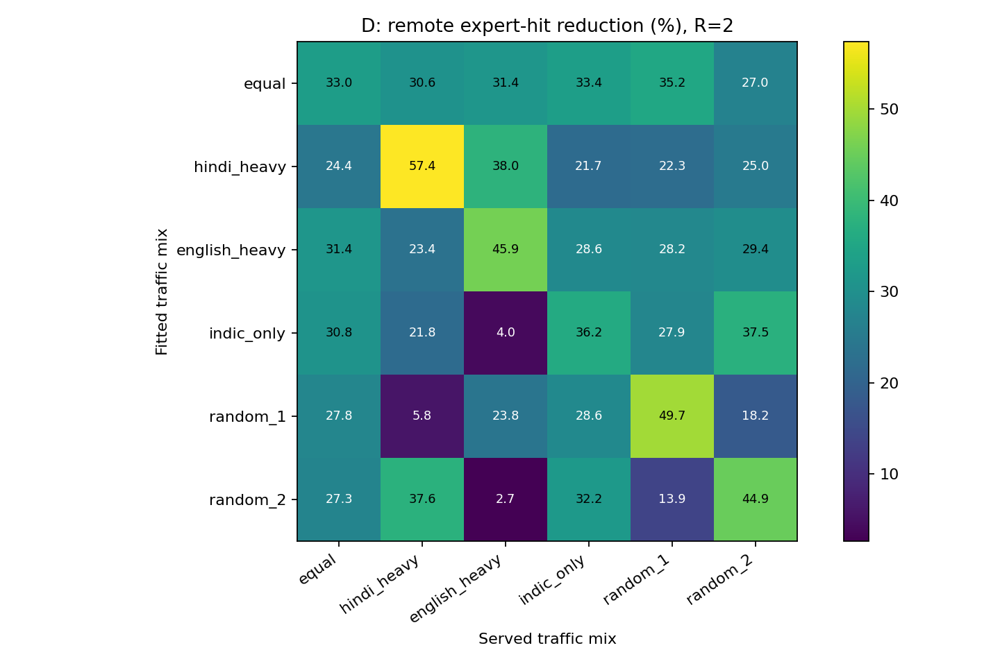
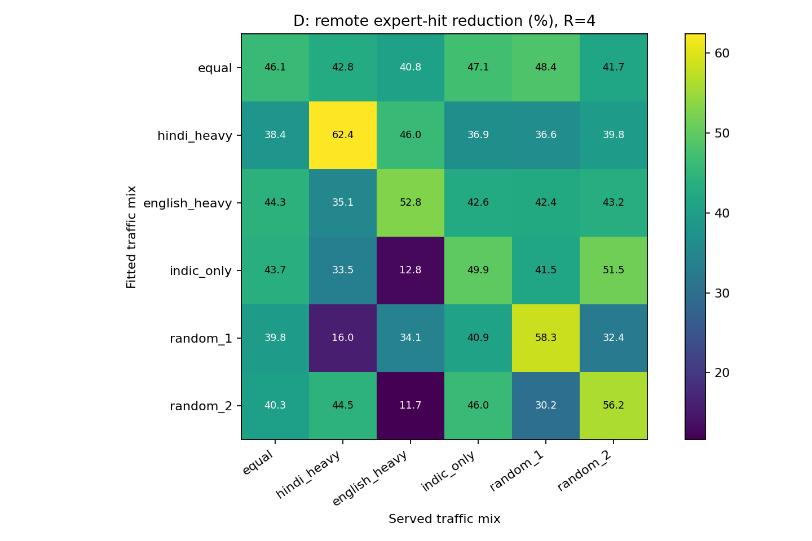

# Local ablation findings — 9 November 2026

**Executed on this Mac using CPU only. No model weights, training, cloud resources or GPU benchmarks were used.**

## What was run

Setup and A–D from the mentor repository. A/C:4and8 simulated GPUs. B:4 simulated GPUs. D:4 simulated GPUs, six fit mixtures × six served mixtures × two replica budgets. Source is the supplied Qwen3-30B-A3B/Wikipedia count file only: these runs do not reproduce the newer Sarvam, FLORES or Hinglish results in Raj’s email.

## Main findings

1. **The baseline reproduces.** Four-GPU aware locality0.3442 and baseline0.2569 meet the supplied tolerance.

2. **Layout and request homing explain most of A’s language-aware advantage.** At R2/four GPUs the fully-aware plan gains9.975 percentage points of traffic reduction over blind; language-specific copy choice contributes only0.317 points of that.

3. **Balance-aware placement preserves most savings.** At R2/four GPUs, cap1.1 IP gives32.014% reduction versus33.046% for unconstrained aware placement, while mean layer imbalance falls from1.987 to1.261.

4. **Allocate copies by traffic benefit, not language specificity alone.** Greedy gain gives34.291% reduction on four GPUs,1.244 points over uniform, and33.004% on eight GPUs,1.454 points over uniform. Concentrating the budget in the12most specific layers performs worse than uniform on both GPU counts.

5. **Indic-only gains remain in this simulation.** Matched Indic-only R2 gives36.207% reduction versus25.104% for blind:11.103percentage points advantage. This is not evidence that Indic languages are highly distinct, nor does it isolate language labels from request homing/layout.

6. **Traffic shifts are a serious weakness.** Worst of the tested R2 mixtures loses51.555percentage points relative to a matched-fit plan. This is a static mixture mismatch result, not a dynamic adaptation or migration experiment.

## Equal traffic, four GPUs, two extra experts per GPU per layer

All percentages below use a language-blind, no-copy default with local share1/G as the common reference. This differs from the home-conditioned default reported by analyze.py. A percentage-point advantage is a difference of traffic-reduction percentages, not a relative percentage improvement.

| Plan | Local expert hits (%) | Remote-hit reduction (%) | Mean layer imbalance |

|---|---:|---:|---:|

| blind | 42.30 | 23.07 | 1.246 |

| aware_blind_copies | 49.55 | 32.73 | 1.984 |

| aware | 49.78 | 33.05 | 1.987 |

| aware cap1.1 IP | 49.01 | 32.01 | 1.261 |

| aware cap1.1 greedy | 48.30 | 31.06 | 1.129 |

## What surprised us / questions for Raj

- Removing English did not remove the simulated advantage. Check whether home assignment and the particular grouping constraints account for this, rather than interpreting it immediately as strong Indic language separation.

- A strict fit-load cap preserved nearly all four-GPU traffic savings after replicas. Consider replica-adjusted load directly in a future planner; the requested cap currently constrains primaries only.

- The most language-specific layers are not automatically where memory buys the most traffic reduction. Fit-half marginal gains are the better objective in C.

- A layout optimal for primary locality may not be optimal after copies, and an optimal fit solution need not beat a heuristic on held-out data.

## Evidence and limits

Traffic is a remote expert-hit proxy calculated from marginal counts. It is not measured network bytes, all-to-all time or p99 latency. Counts do not retain per-token expert co-selection, so token-transfer deduplication and co-selection graph objectives cannot be reconstructed exactly. Equal expert sizes, GPU compute speeds and uniform per-layer averaging are assumed. GPU/PCIe topology, scheduling, attention/KV pressure and replica migration costs are absent. The 300-candidate grouping search is seeded but heuristic; IP optimality applies only to fixed groups, specified capacity constraints and the primary-locality objective.

No per-sentence raw observations are available here for bootstrap uncertainty. No new claims about Sarvam, code-mixed input, padding, licensing or model quality are established by this analysis. D uses served-mixture-aware blind copies as a strong reference, and includes zero-weight English in the group search. Heavy traffic concentrates compute; locality alone is not throughput.

## Files

- [Setup explanation](SETUP.md)

- [A table](A/table.csv) · [A notes](A/NOTES.md)

- [B table](B/table.csv) · [B notes](B/NOTES.md)

- [C table](C/table.csv) · [C notes](C/NOTES.md)

- [D table](D/table.csv) · [D notes](D/NOTES.md)

- [Validation](validation.txt) · [Run manifest](manifest.json)

## Figures

