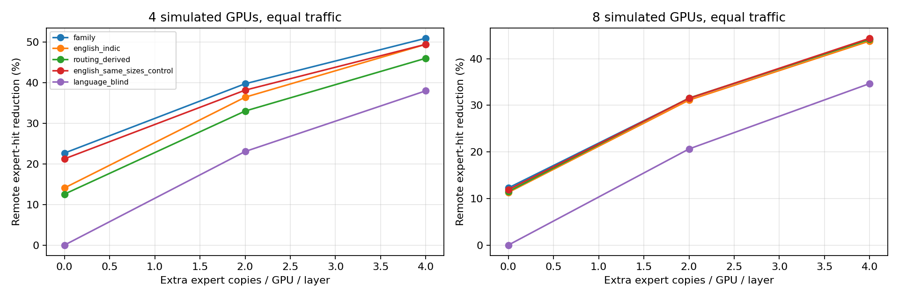
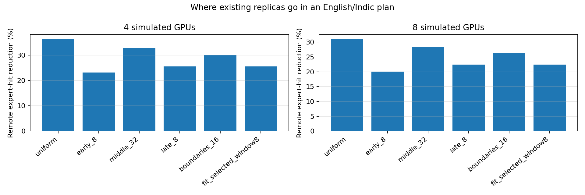

# Ramji’s additional ablations — 9 November 2026

Executed locally with supplied Qwen3/Wikipedia marginal expert counts. No GPU, cloud, model weights, training or messages to Raj. Original A–D outputs preserved in a separate snapshot.

## 1. Do linguistic families help?

English stays separate; Indic languages are divided into Indo-Aryan (Hindi,Bengali,Marathi,Gujarati,Punjabi) and Dravidian (Tamil,Telugu,Kannada,Malayalam). Classification: [Census of India, Statement9](https://censusindia.gov.in/nada/index.php/catalog/42458/download/46089/C-16_25062018.pdf). English is an experimental separate group, not an Indo-Aryan language.

Every GPU keeps128/G primary expert slots and the same replica allowance. Family groups are subdivided into home GPUs with fit-only optimization:4GPUs allocate1English,2Indo-Aryan,1Dravidian;8GPUs allocate1English,4Indo-Aryan,3Dravidian. No expert is made exclusive to a family.

| Equal traffic, R2 | 4GPU remote-hit reduction | 4GPU mean imbalance | 8GPU remote-hit reduction | 8GPU mean imbalance |

|---|---:|---:|---:|---:|

| family | 39.78% | 2.539 | 31.49% | 3.345 |

| english_indic | 36.46% | 1.643 | 31.11% | 3.311 |

| routing_derived | 33.05% | 1.987 | 31.55% | 3.147 |

| english_same_sizes_control | 38.19% | 2.621 | 31.50% | 3.325 |

| language_blind | 23.07% | 1.246 | 20.63% | 1.519 |

- 4 GPUs: family plan beats 19/20 shuffled-family controls. Shuffled range 37.378–39.932%; same-size English-separated routing control differs by +1.582 percentage points. These are exploratory, sampled controls—not significance claims.

- 8 GPUs: family plan beats 9/20 shuffled-family controls. Shuffled range 30.920–32.182%; same-size English-separated routing control differs by -0.012 percentage points. These are exploratory, sampled controls—not significance claims.

Held-out Indic routing distances: mean within-family JS 0.03223 bits; between-family 0.03961 bits. Lower means more similar. This is descriptive association, not proof that ancestry causes routing or that a family plan is best.

**Interpretation:** Family grouping can change locality, but does not give a consistent advantage after controls and load balance. In particular, the four-GPU family plan concentrates more compute than the English/Indic pool. English-separated routing and family policies use different group sizes from the old baseline, so raw differences cannot be credited solely to family labels.

## 2. English separate, Indic pooled; vary layer replica locations

This tests where existing expert replicas are placed. English has one home GPU and Indic languages use the remaining pool, with fixed home assignments across layers. Every policy has96copies per GPU across48layers.

| Replica allocation | 4GPU remote-hit reduction | 8GPU remote-hit reduction |

|---|---:|---:|

| uniform | 36.46% | 31.11% |

| early_8 | 23.21% | 20.10% |

| middle_32 | 32.80% | 28.29% |

| late_8 | 25.56% | 22.43% |

| boundaries_16 | 30.06% | 26.27% |

| fit_selected_window8 | 25.56% | 22.43% |

**Interpretation:** Spreading replicas uniformly beats middle-only and concentrated boundary windows in this fixed-budget test. It does not support a blanket “replicate middle layers” rule for this checkpoint/data.

## What was preserved

[Separate Raj A–D bundle](../raj-requested/submission.zip) and submission archive remain unchanged. A copy is also stored under results/preserved-mentor-ablations/2026-11-09, with hashes.

## Limits

All “reductions” are remote expert-hit proxies against a uniform-origin, no-copy baseline1/G. They are not network bytes, collective counts, runtime or p99 latency. Routing overlap, tokenization/script, domain and training may all correlate with family. Only one checkpoint and Wikipedia splits are available here. No Hinglish, Sarvam or FLORES result is newly established. Unbalanced group sizes create request/attention load differences; all reported mean imbalance values concern expert-hit work, not total GPU time. The controls do not eliminate every grouping-search confound.

## Results and artifacts

[E table](E/table.csv) · [E notes](E/NOTES.md) · [Shuffled controls](E/shuffle-control.csv) · [F table](F/table.csv) · [F notes](F/NOTES.md) · [Validation](family-validation.txt)

