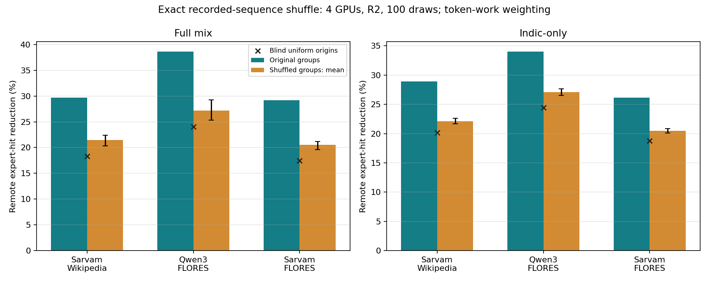
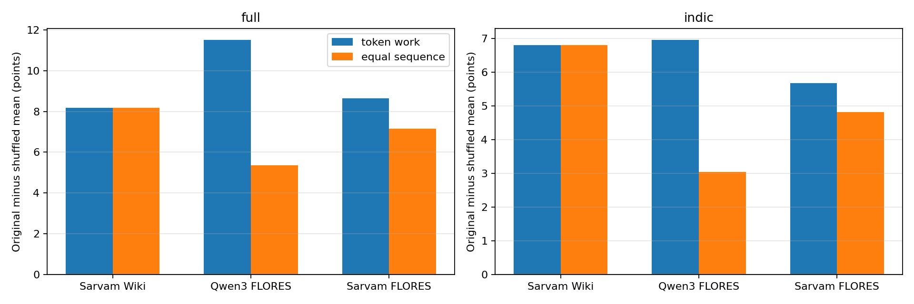
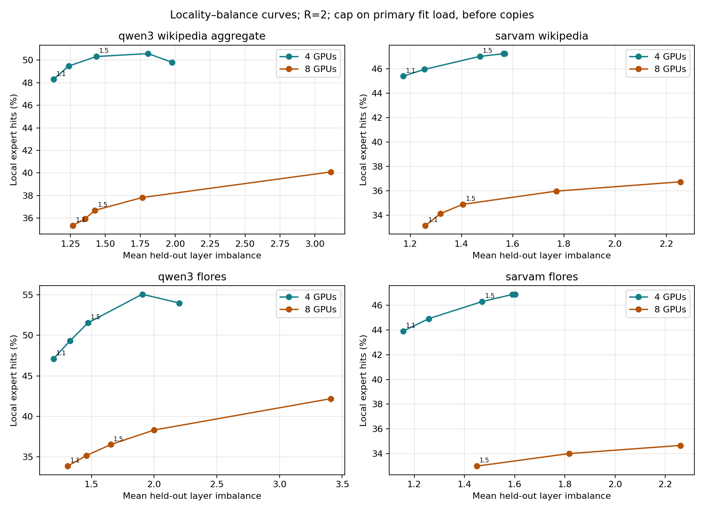
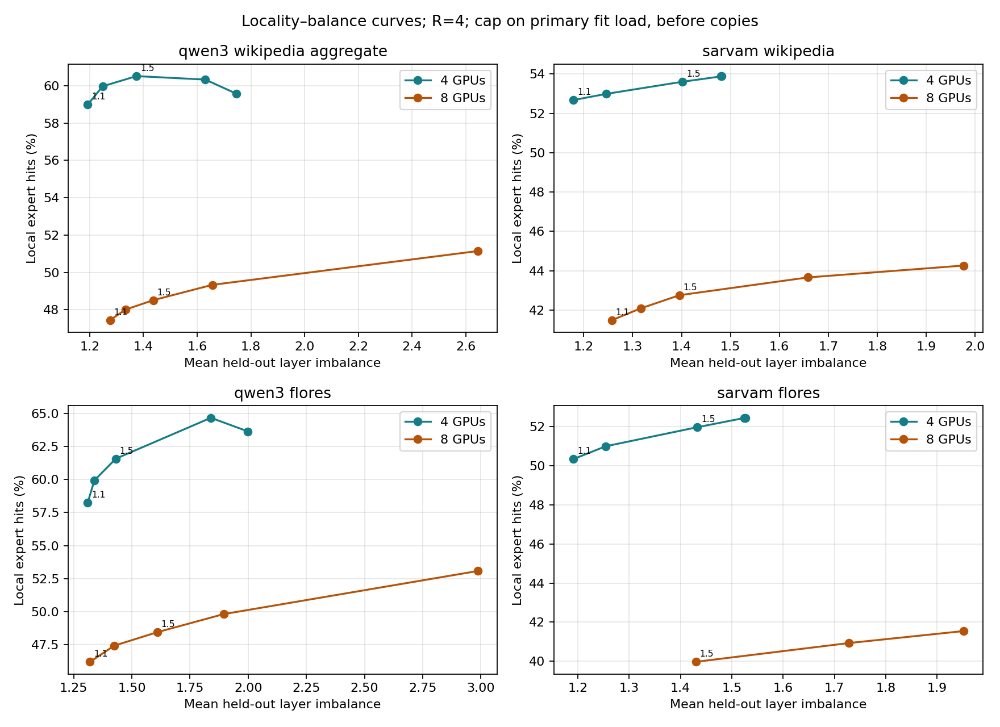
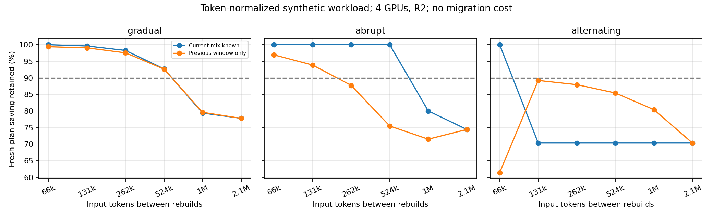

# Exact-sequence follow-up — 9 November 2026

New local results using upstream per-sequence data. Earlier A–F and approximation reports are unchanged. No GPU/cloud execution, training, model-weight download or new routing collection.

## Main findings

1. **Meaningful language grouping adds held-out locality in the available datasets.** Original groups outperform refitted shuffled groups on Sarvam Wikipedia and both FLORES models, including Indic-only traffic. This is a stronger control than the earlier expected-demand approximation, but applies to different available datasets; Qwen3 Wikipedia remains untested exactly.

2. **The effect is not just variable sentence length.** Equal-sequence weighting and sentence-matched FLORES shuffles retain a positive original-minus-shuffle difference. Its size changes substantially with weighting, especially on Qwen3 FLORES.

3. **Locality and balance have a measurable simulated trade-off.** New curves show both4and8GPUs over five fit-primary caps, with R2/R4 figures and R0/R2/R4 tables. A separate panel retains the earlier Qwen3 Wikipedia aggregate-count curve. No best deployment point or global optimum is claimed.

4. **Rebuild intervals are now stated in input tokens.** This is a declared token scale for the previous synthetic scenarios, not newly measured temporal traffic or a production cadence.

## Exact request shuffle: what changed

Actual sequence records are reassigned among the learned home groups. Their expert histograms never change. Each group keeps the exact same number of sequences; fit and evaluation shuffles are independent, and each shuffled plan is fitted only on shuffled fit records. There are100draws per condition, withR2/R4. The100draws are reproducible from saved assignment arrays and sequence IDs.

Original home groups are selected from300fit-only balanced-language-count candidates, then fixed as group capacities for the conditional request shuffle. The home-group search is not repeated for every randomized labeling. This is a conditional grouping test, not a formal pipeline-wide permutation-significance claim. Shuffling preserves request counts, not token counts or original labels within groups.

### Primary token-work weighting: 4GPUs, R2

All values below are remote expert-hit reduction percentages against a no-copy, uniform-origin baseline. Longer supplied requests contribute more expert work.

| Dataset | Mix | Original | Shuffled mean | Shuffled draw range (2.5–97.5%) | Original minus shuffle (points) | Blind comparator |
|---|---|---:|---:|---|---:|---:|
| sarvam_wikipedia | full | 29.65% | 21.49% | 20.35–22.42% | 8.17 | 18.30% |
| sarvam_wikipedia | indic | 28.94% | 22.14% | 21.66–22.60% | 6.80 | 20.17% |
| qwen3_flores | full | 38.65% | 27.16% | 25.29–29.23% | 11.50 | 24.02% |
| qwen3_flores | indic | 34.04% | 27.09% | 26.54–27.65% | 6.95 | 24.42% |
| sarvam_flores | full | 29.19% | 20.55% | 19.59–21.20% | 8.64 | 17.44% |
| sarvam_flores | indic | 26.17% | 20.49% | 20.09–20.82% | 5.68 | 18.80% |

**Interpretation:** Savings do not disappear under random grouping, so homing/layout/replication still contribute. But original groups retain a substantial additional locality benefit. For Indic-only R2 the original-minus-shuffled mean is6.80points on Sarvam Wikipedia,6.95on Qwen3 FLORES and5.68on Sarvam FLORES. This does not mean linguistic family is the cause; script, tokenization, training, domain and other language-correlated features are not separated by this control.

Original results exceed all100draws in each reported control/weighting/budget. The draw ranges describe the randomized-label distribution, not population confidence intervals. We do not call0/100 a zero p-value or claim formal significance after fit-group selection.

### Length and parallel-content controls

Equal-sequence sensitivity divides each histogram by that sequence’s valid token length. Under global shuffling, Indic-only R2 differences remain6.80points on Sarvam Wikipedia,3.04on Qwen3 FLORES and4.82on Sarvam FLORES. Wikipedia sequences all have512tokens, so the two weighting methods agree there.

FLORES additionally shuffles within each parallel sentence index, independently in fit and evaluation. Original-minus-shuffle differences remain positive; the token-work Indic-only R2 differences are6.97points for Qwen3 and5.66for Sarvam. This controls the parallel-content structure while preserving group cardinality. These controls are paired variations, not independent replications or separate models.

## Data checks and coverage

Sarvam Wikipedia:96sequences/language,48fit+48eval; both models’ FLORES:500sentences/language,250fit+250eval. Full mix has10languages; Indic-only9. Sarvam uses18MoElayers,128routed experts,top6; Qwen3 uses48layers,128experts,top8. Every sequence/layer sum was checked against top-k × valid tokens, and CSV/NPZ alignment and IDs verified. Sarvam shared-expert compute is excluded.

Qwen3 Wikipedia per-sequence data includes only English, so no exact multi-language shuffle is claimed for it. Its old aggregate counts remain usable for the balance curve. Code-mixed records have split=none and were not added to this fit/evaluation experiment.

## Locality–imbalance curves

Each dataset has4/8GPU greedy curves at caps1.1/1.25/1.5/2/none, with identical home groups across the cap sweep. Caps constrain PRIMARY FIT expert load before replicas. Held-out final load, attention/KV work and actual GPU time are not capped. Greedy solutions are feasible heuristics, not certified optima. Mean and worst-layer imbalance are both in the table.

The prior Qwen3 Wikipedia panel uses earlier equal-language-token weighting. New per-sequence panels use observed token work under equal request sampling per language. Do not interpret differences between datasets as only model differences. The earlier four-GPU32.01%/1.26headline came from an exact IP; these matched4/8curves are greedy.

| Dataset | GPUs | R2, cap1.1 local hits | Mean held-out imbalance | Uncapped assignment local hits | Uncapped imbalance |
|---|---:|---:|---:|---:|---:|
| qwen3_wikipedia_aggregate | 4 | 48.30% | 1.129 | 49.78% | 1.987 |
| qwen3_wikipedia_aggregate | 8 | 35.34% | 1.269 | 40.11% | 3.147 |
| sarvam_wikipedia | 4 | 45.39% | 1.172 | 47.24% | 1.577 |
| sarvam_wikipedia | 8 | 33.15% | 1.259 | 36.73% | 2.255 |
| qwen3_flores | 4 | 47.10% | 1.198 | 53.99% | 2.201 |
| qwen3_flores | 8 | 33.88% | 1.310 | 42.19% | 3.413 |
| sarvam_flores | 4 | 43.91% | 1.156 | 46.89% | 1.601 |
| sarvam_flores | 8 | Infeasible | Infeasible | 34.68% | 2.259 |

**Infeasible caps:** On eight-GPU Sarvam FLORES, MoE layer10 has a primary-slot lower bound of1.268614: whichever GPU owns the hottest expert must also hold15other experts, and even choosing the15least-loaded others exceeds caps1.1and1.25. These points are impossible under the original pre-replica primary-load constraint, not merely unproven greedy failures. The remaining8GPU curve has three cap points. See fit_lower_bounds.csv and infeasible_caps.csv.

## Rebuild intervals in input tokens

The previous synthetic scenario is now explicitly scaled to128requests ×512inputtokens =65,536inputtokens per window. Its32windows serve2,097,152inputtokens. Test intervals are65,536;131,072;262,144;524,288;1,048,576;2,097,152inputtokens. One-window observation lag is65,536tokens. All earlier relative-saving measurements are unchanged.

WithR2andlagged-mixture information, gradual drift retained≥90%of fresh-plan average saving at tested intervals up to524,288inputtokens; abrupt8-window regimes at up to131,072tokens. No tested interval passed for the rapidly alternating trajectory. Different token scales or change points imply different thresholds. These are conditional synthetic outcomes, not empirically calibrated refresh recommendations.

No generated/output token counts, migration traffic, rebuild disruption, drift detection error or serving timing is measured. Re-expressing windows in tokens does not create that missing information.

## Overall conclusion for Raj

The exact recorded-request controls support a language/home association benefit in held-out locality on all three available datasets, including Indic-only. Thus the Indic-only gain cannot be explained entirely by arbitrary request homing under this replay. A non-language residual still survives the shuffle. The magnitude depends on workload weighting.

The main next artifact can be the locality–imbalance curve, with language-blind and randomized-home controls and a clearly stated memory budget. Actual all-to-all bytes and end-to-end/p99 latency on PCIe hardware are still needed; no hardware speedup or novelty claim is established here.

## Limitations

Recorded routes are frozen. Source documentation reports BF16 batch-dependent expert choices; re-batching on a serving engine may alter them. Pairwise co-selection/token-transfer deduplication and migration costs are absent from these marginal-hit simulations. FLORES parallel requests are not independent language samples; sentence-blocked controls address content structure but not every confound. No language-family method was extended.

## Files

[Protocol](PROTOCOL.md) · [Validation](validation.txt) · [Manifest](manifest.json) · [Complete bundle](exact-followup-results.zip)

- [Exact shuffle summaries](shuffle/summary.csv) · [All4000evaluations](shuffle/trials.csv) · [Sequence IDs/groups](shuffle/metadata.json)

- [Curve table](curves/table.csv) · [Fit-cap feasibility](curves/feasibility.csv)

- [Token-based rebuild table](rebuild_tokens/table.csv) · [Scenario definition](rebuild_tokens/scenario.json)

