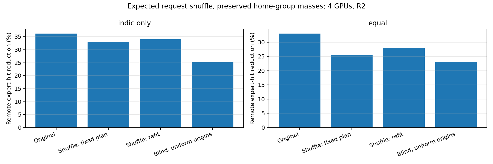
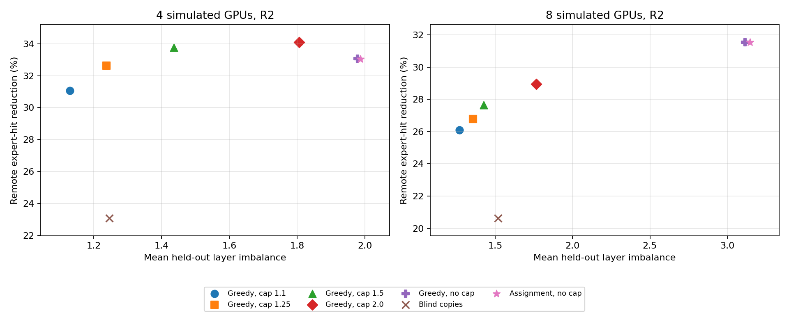
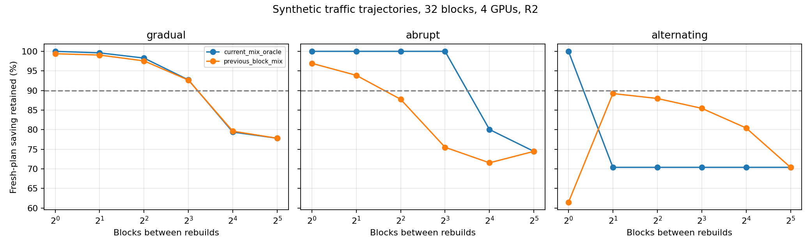

# Raj follow-up — local results, 9 November 2026

**New run; earlier A–F and published results are unchanged. CPU count-based analysis only.**

## What was completed and what remains

- Completed: full eight-GPU B greedy sweep and matching four-GPU reference; all48layers, five caps and three replica budgets.

- Completed: randomized-homing expectation controls and separate whole-language grouping shuffles for Indic-only and full mixes. **The literal request-level shuffle remains unrun:** per-request expert traces are missing.

- Completed: rebuild-interval sensitivity on explicitly synthetic traffic trajectories, with current-mixture and lagged-mixture controls. No real-time refresh interval is established.

- Family grouping was not extended. No GPU/cloud runs, new model inference, training, joint planner or architectural intervention.

## 1. Does the saving survive loss of language information?

The NPZ has per-language fit/evaluation marginal counts and fit-only expert pair counts, not per-request expert traces. Simply renaming labels or moving whole languages is not a request-label shuffle. We therefore remove the language/home association in expectation by giving every random pseudo-language the SAME aggregate expert profile while preserving each group’s request mass. Fit/evaluation halves remain separate.

### Four simulated GPUs, two replicas per GPU per layer

| Traffic | Original | Expected shuffle, frozen original plan | Expected shuffle, refitted layout/copies | Blind uniform-origin comparator |
|---|---:|---:|---:|---:|
| indic_only | 36.21% | 32.91% | 33.99% | 25.10% |
| equal | 33.05% | 25.50% | 28.00% | 23.07% |

Values are remote expert-hit reductions against the no-copy uniform-origin1/G baseline, not measured byte reductions.

- indic_only: advantage above blind is 11.10 percentage points originally and 8.89 after expectation/refit; 80.0% of that incremental advantage survives. Original-minus-refitted-null is 2.22 points.

- equal: advantage above blind is 9.98 percentage points originally and 4.93 after expectation/refit; 49.4% of that incremental advantage survives. Original-minus-refitted-null is 5.05 points.

**Interpretation:** Much of the Indic-only advantage can arise from homing/layout without meaningful language labels in this expected-demand model. A smaller residual remains, and the full mix loses more when language/home association is removed. This is suggestive, not the literal randomized-request control Raj requested and not proof of a causal language contribution. Finite-shuffle variability and fit adaptation to random sample noise cannot be recovered.

The refitted null minimizes expected demand, not the expectation of an optimum fitted to finite shuffled requests. Frozen-plan local share is linear and has an exact random-assignment expectation for these fixed-length requests; mean/max imbalance computed on expected loads is not the expectation of finite-shuffle maxima. Original home-group masses can be unequal, unlike the blind uniform-origin comparator. No load-cap matching is imposed in this D control.

A separate100whole-language-profile permutations per mix are saved, at R2/R4. They preserve packet identity and are a weaker random-grouping check; do not use them as a substitute for randomized individual requests.

## 2. B on eight GPUs: complete greedy sweep

Every cap and replica budget ran across all48layers. Greedy is not a certified optimum. Four-GPU metrics exactly reproduce the earlier greedy baseline; the previous headline32.01%/1.26 result used the exact four-GPU IP, so do not compare those as the same solver. The cap retains original B semantics: primary fit load BEFORE copies, not held-out final load.

| GPUs, R2 | Method | Fit primary cap | Remote-hit reduction | Mean held-out imbalance | Worst-layer held-out imbalance |
|---|---|---:|---:|---:|---:|
| 4 | unconstrained_assignment | reference | 33.05% | 1.987 | 2.581 |
| 4 | greedy | 1.1 | 31.06% | 1.129 | 1.359 |
| 4 | greedy | 1.25 | 32.63% | 1.237 | 1.382 |
| 8 | unconstrained_assignment | reference | 31.55% | 3.147 | 4.446 |
| 8 | greedy | 1.1 | 26.11% | 1.269 | 1.505 |
| 8 | greedy | 1.25 | 26.79% | 1.355 | 1.685 |

**Interpretation:** Eight-GPU balancing greatly reduces overload, with a larger locality trade-off than the earlier four-GPU headline. This supplies the missing second GPU count as a heuristic result, not an eight-GPU optimality claim.

## 3. How often must the plan be rebuilt?

We lack real temporal request arrivals. The test uses three32-block scenarios, equal work per block, periods1/2/4/8/16/32, R2/R4. A fresh plan is fit using only the fit-half language profiles and a bounded pool of six pre-existing candidate groupings. A current-mixture oracle is compared against a planner that observes only the previous block’s mix. No reconfiguration or migration overhead is charged.

“Most” was defined as≥90% of the current-mixture fresh planner’s average remote-hit saving. The table reports all tested intervals passing that criterion with R2 and lagged information.

| Synthetic trajectory | Lagged-information intervals retaining ≥90% | What it means |
|---|---|---|
| gradual | [1, 2, 4, 8] | Slow drift tolerates less frequent updates in this scenario. |
| abrupt | [1, 2] | Regime changes require more frequent updates. |
| alternating | none | One-block-old information is systematically stale; no tested interval passes. |

**Interpretation:** No universal seconds-based rebuild frequency follows. Drift speed, detection delay, periodic phase and migration cost matter. Retaining90%of absolute saving is easier than recovering90%of the adaptation gain over never rebuilding; both are recorded. Alternating trajectories expose phase/alias effects, so a nonmonotone result is not a general refresh recommendation.

## What to tell Raj

The eight-GPU greedy follow-up is complete. The count-based randomized-homing expectation suggests most of the Indic-only advantage is not specific to language labels, but the requested finite request shuffle still needs per-sequence routing counts. We should obtain fit/evaluation per-sequence expert histograms with request IDs/language and token counts, shuffle labels independently within each split while preserving group cardinalities, refit on shuffled fit data, and repeat seeded evaluation draws. No need to rerun GPU routing if those histograms were retained. The next paper claim should remain about locality/balance until actual bytes and latency are measured.

## Reproducibility and files

[Protocol](PROTOCOL.md) · [Validation](validation.txt) · [Manifest](manifest.json) · [Complete bundle](followup-results.zip)

- [Shuffle table](shuffle/table.csv) · [Control details](shuffle/NOTES.md)

- [Eight-GPU B table](balance8/table.csv) · [Layer feasibility](balance8/layer-checks.csv)

- [Rebuild table](rebuild/table.csv) · [Block-level results](rebuild/block-results.csv) · [Trajectories](rebuild/trajectories.json)

